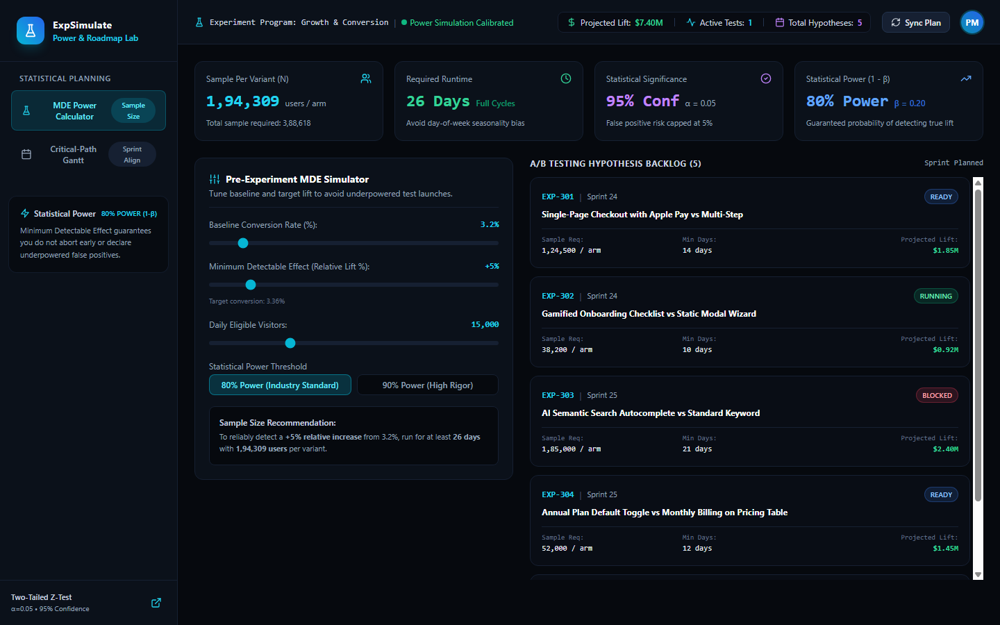

# Experimentation Roadmap Simulator & MDE Power Calculator

[]()
[]()
[]()
[]()
[]()

> Product experimentation planning and critical-path sprint roadmap simulator. Calculates statistical sample sizes and experiment runtime durations via Minimum Detectable Effect (MDE) power modeling, aligns A/B testing hypotheses with engineering milestone velocity, and resolves dependency bottlenecks.

---

## 📸 Platform Dashboard



---

## ⚡ Core Product Capabilities

- **Interactive MDE Power & Sample Size Simulator:** Dynamically computes required sample sizes per variant across varying baseline conversion rates, relative lifts, and statistical power (80% vs 90%).
- **Critical-Path Milestone Gantt:** Visualizes engineering sprint dependencies (e.g. Vector DB Search Cluster, Stripe SDK Integration) mapped against upcoming product experiments.
- **Seasonality & Runtime Calibration:** Enforces full 7-day or 14-day cycle guidelines to eliminate day-of-week conversion bias.
- **ARR Lift Projection Engine:** Directly quantifies annual business revenue value expected from statistically valid experimentation wins.

---

## 🏗️ Architecture & Planning Pipeline

```mermaid
flowchart LR
    A[Product Hypothesis\ne.g. One-Click Apple Pay] --> B[MDE Statistical Calculator\nBaseline Conv + Target Lift]
    B --> C[Sample Size & Runtime Engine\nTwo-Proportion Z-Test (α=0.05, β=0.20)]
    C --> D{Traffic & Runtime Feasible?\nSample vs Daily Visitors}
    D -->|Yes| E[Critical-Path Milestone Gantt\nSprint Scheduling]
    D -->|No / Underpowered| F[Rethink Hypothesis ⚠️\nGroup Variants or Increase MDE]
    E --> G[Production Experiment Launch 🚀]
```

---

## 📊 Dataset Benchmark Reference

Bundled benchmark dataset located at `data/kaggle_experimentation_roadmap_metrics.csv`:

| Exp ID | Hypothesis Title | Baseline % | MDE Lift % | Power | Sample / Arm | Days | Projected Lift |
| :--- | :--- | :--- | :--- | :--- | :--- | :--- | :--- |
| `EXP-301` | Single-Page Checkout with Apple Pay | 3.2% | +5.0% | 80% | 124,500 | 14 | $1.85M |
| `EXP-302` | Gamified Onboarding Checklist | 14.5% | +10.0% | 80% | 38,200 | 10 | $0.92M |
| `EXP-303` | AI Semantic Search Autocomplete | 8.0% | +4.0% | 80% | 185,000 | 21 | $2.40M |
| `EXP-304` | Annual Plan Default Toggle | 6.5% | +8.0% | 85% | 52,000 | 12 | $1.45M |
| `EXP-305` | Social Proof Live Buyer Toasts | 2.1% | +12.0% | 80% | 68,000 | 9 | $0.78M |

---

## 🚀 Quickstart Guide

### Option 1: Docker Compose

```bash
git clone https://github.com/Prasunnandi/experimentation-roadmap-simulator.git
cd experimentation-roadmap-simulator
docker-compose up --build
```
- Web Dashboard: `http://localhost:3000`
- REST API: `http://localhost:8000`

### Option 2: Local Development

```bash
# 1. Start Backend API
cd backend
npm install
npm run dev

# 2. Start React Dashboard
cd ../frontend
npm install
npm run dev
```

---

## 🛠️ API Reference

- `GET /api/experiments` - Retrieves all experiment hypotheses with sample size projections.
- `POST /api/mde-calculate` - Computes required sample sizes per arm using Evan Miller's two-proportion statistical formulas.
- `GET /api/roadmap` - Retrieves sprint milestone dependencies and critical-path blockers.

---

## 📄 License

MIT © [Prasun Nandi](https://github.com/Prasunnandi)
